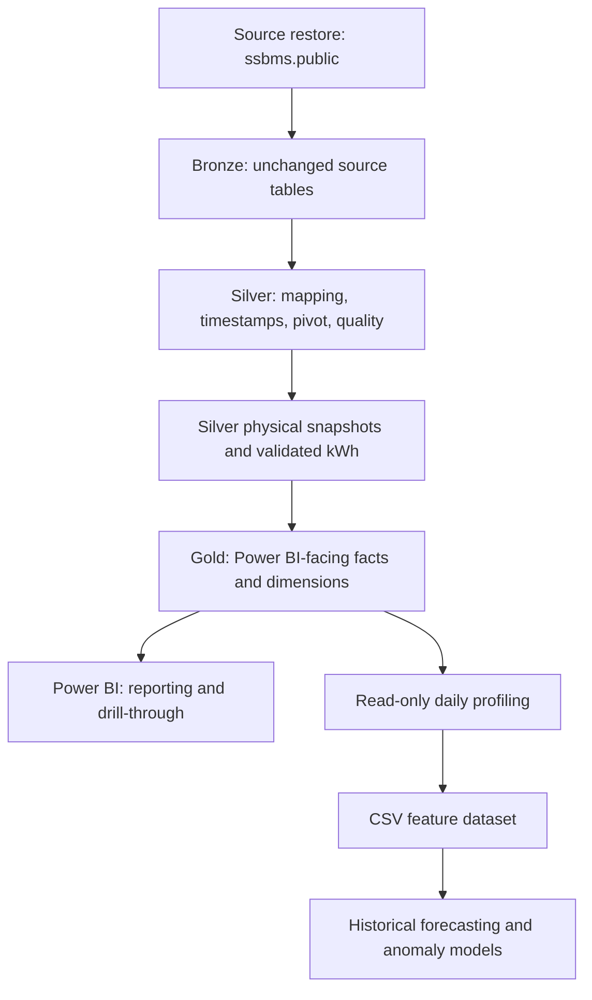

# SADINhub Current End-to-End Data and Machine Learning Pipeline

**Project:** Energy Intelligence and Predictive Analytics Platform  
**Prepared for:** Shafey Siddiqui  
**Current-state date:** 8 September 2026  
**Database:** PostgreSQL 18, database `sadinhub`  
**Analytics tools:** pgAdmin 4, Power BI Desktop, VS Code, Python 3.12.4  
**Document status:** Current implementation record

## 1. Document purpose and authority

This document records the SADINhub pipeline that is currently implemented or currently being used. It covers the electrical-energy path from the restored source data through Bronze, Silver, Gold, Power BI, daily ML preparation, and the latest historical ML experiment.

The evidence was reconciled using this order of authority:

1. Live PostgreSQL metadata and implemented rules captured in the Data Dictionary, updated from the database on 24 August 2026.
2. Reconciled row counts and findings in the Data Assessment and EDA reports dated 27 August 2026.
3. The current Power BI model decisions confirmed during dashboard work.
4. The read-only daily export produced on 6 September 2026.
5. The latest multi-meter ML experiment completed on 7 September 2026.

Where an operational fact has not been formally established, this document labels it **TBD** or **not formally documented**. It does not turn a proposed design into an implemented component.

## 2. Project objective and scope

The project converts SADINhub's historical IoT electrical telemetry into:

- an auditable analytics-ready data pipeline;
- data-quality evidence and documented business rules;
- Power BI reporting and investigation views;
- exploratory business and engineering findings;
- next-day energy-consumption forecasting prototypes; and
- a daily-consumption anomaly-review prototype.

The current project scope is electrical energy data. Water-related tables and analysis are excluded. Production deployment and changes to live customer systems are outside the project charter.

## 3. Current architecture



The governing design principles are:

- **Bronze remains unchanged.** Source values are preserved.
- **Native grain is retained through Gold.** The main analytical fact remains approximately one row per meter every five minutes. The database does not pre-aggregate the main fact to hourly, daily, weekly, or monthly grain.
- **Business corrections are isolated in Silver.** They do not rewrite the source.
- **Quality classifications are diagnostic overlays.** They do not replace the measured electrical values.
- **Validated consumption is a separate derived fact.** It does not alter the raw cumulative register.
- **Power BI performs reporting aggregation.** It uses Gold objects as its governed database source.
- **The ML branch is isolated.** The present Python work reads the database with read-only enforcement and writes files outside PostgreSQL. It does not alter the existing database or Power BI model.

## 4. Platform and working environment

| Component | Current use |
|---|---|
| PostgreSQL 18 | Stores the Bronze, Silver, and Gold schemas in the local `sadinhub` database. |
| pgAdmin 4 | Runs SQL, inspects metadata, and validates results. |
| Power BI Desktop | Holds reporting calculations, relationships, pages, filters, and drill-through behavior. |
| VS Code | Current Python development environment. |
| Python 3.12.4 | Runs read-only data preparation and historical ML experiments. |
| Python virtual environment | `ML_WORK/.venv`; contains pandas, NumPy, scikit-learn, SQLAlchemy, psycopg, matplotlib, and supporting packages. |

Database credentials are entered at runtime. The current Python project does not save the PostgreSQL password in source files.

## 5. Bronze layer

### 5.1 Purpose

Bronze is the source-restored system-of-record layer. It contains approximately 107 source tables. The electrical pipeline depends primarily on:

| Object | Role |
|---|---|
| `bronze.energy_meters` | Source meter records and relationships to devices and business entities. |
| `bronze.telemetries` | Long-format telemetry values. The database contained approximately 109 million telemetry rows at the documented extraction point. |
| `bronze.telemetries_dictionaries` | Maps each telemetry `key_id` to its measurement name. |

### 5.2 Source grain and fields

`bronze.telemetries` stores one measurement per row. Its important fields are:

- `device_id`: the reporting device identifier;
- `key_id`: the measurement identifier;
- `timestamp`: epoch time in milliseconds; and
- typed value fields such as `dbl`, which holds the electrical measurements.

A meter reading packet is a unique `(device_id, timestamp)` combination. In the validated window, a packet normally contains about 24 populated electrical-key rows. Silver pivots those rows into one wide analytical record.

### 5.3 Bronze controls

The current pipeline does not trim, interpolate, permanently convert, or overwrite Bronze values. Any canonical mapping correction is applied after Bronze, and the original identifiers remain available for traceability.

## 6. Silver layer

Silver standardizes the source structure, resolves approved meter mappings, creates business-readable electrical columns, applies data-quality logic, and derives validated interval consumption.

### 6.1 Current Silver objects

| Object | Type | Grain or cardinality | Current role |
|---|---|---:|---|
| `silver.dim_energy_meter_staging` | View | One canonical reporting device/meter | Joins source meter and device metadata, assigns facility/zone/billing keys, and applies approved mapping rules. |
| `silver.dim_meter_cb_rating` | Table | 31 rows | Stores the real circuit-breaker maximum current for each canonical meter. Values range from 80 A to 250 A. |
| `silver.energy_meter_mapping_audit_staging` | View | One row per mapping candidate | Preserves candidate mappings, ranking, business-rule codes, and `KEEP`/`EXCLUDE` decisions. |
| `silver.dim_grid_billing_account_staging` | View | One row per billing account | Enriches account metadata and configured capacities/fees. It is not a verified tariff engine. |
| `silver.fact_energy_readings_staging` | View | One meter x one timestamp | Pivots long telemetry into named electrical columns and derives packet/imbalance diagnostics. |
| `silver.fact_energy_readings_flagged` | View | One meter x one timestamp | Produces quality statuses using the implemented classifier functions. |
| `silver.fact_energy_readings_snapshot` | Physical table | 4,535,918 rows | Combines readings with their statuses for fast analytical access. |
| `silver.fact_energy_consumption_validated` | Physical table | 4,260,849 rows | Applies the approved cumulative-kWh cleaning and differencing logic for 29 included meters. |

Supporting Silver date, facility, and zone dimensions feed the corresponding Gold dimensions. Silver landing views normalize access to source metadata and telemetry before the staging objects apply business rules.

### 6.2 Canonical meter mapping

The pipeline currently resolves 31 canonical energy meters. `energy_meter_key` is the same UUID as the Bronze telemetry `device_id`; the pipeline does not remap this identifier.

The approved mapping rules are:

| Area | Current rule |
|---|---|
| Zone 03 | The source device name `ZN.3-PB_child__1_ch3pm` is represented canonically as `ZN.3-PB.1_child__1_ch3pm` so it agrees with the confirmed meter identity. |
| Zone 13 | Device `ZN.13-PB.1_child__2_ch3pm` legitimately maps to meter `ZN.13-PB.2_child__1_ch3pm`; this is the confirmed one-panel/two-meter exception. |
| Zone 20 | The duplicate crossed mapping from device UUID `9574e049-9fb7-46db-9f8c-b3da0666aea0` to `ZN.20-PB.2_child__1_ch3pm` is excluded. The genuine PB1-to-PB1 and PB2-to-PB2 mappings are retained. |

Every mapping candidate remains visible in `silver.energy_meter_mapping_audit_staging`, including excluded candidates. The canonical view exposes mapping status so a report can distinguish ordinary mappings from confirmed exceptions and review cases.

### 6.3 Timestamp handling and cadence

The source epoch-millisecond timestamp is converted into:

- `reading_timestamp_utc`;
- `reading_timestamp_saudi`; and
- `reading_date_saudi`, using `Asia/Riyadh`.

The PostgreSQL columns named `*_utc` are `timestamp without time zone` values that represent UTC. Python therefore converts them explicitly from UTC before deriving the Saudi-local time; it does not depend on the database session timezone.

Sub-second precision is retained. Timestamps are not rounded into fixed five-minute buckets. The nominal cadence is 300 seconds and 288 readings per day. Most meters are observed around 301.5 seconds, or approximately 286-287 readings per day. The two Zone 13 meters have a stable cadence around 321.17-321.19 seconds, or approximately 269 readings per day. That observed behavior remains in the data.

### 6.4 Telemetry pivot and measurement families

`silver.fact_energy_readings_staging` filters the 32 electrical telemetry keys and pivots them into business-readable columns. The measurement families are:

| Family | Current columns or source keys | Treatment |
|---|---|---|
| Line-to-line voltage | `V1`, `V2`, `V3`, `Va` | Phase values are classified; the average key was unpopulated in the validated window. |
| Line-to-neutral voltage | `Vn1`, `Vn2`, `Vn3`, `Vna` | Phase values are classified; the average key was unpopulated in the validated window. |
| Current | `Amp1`, `Amp2`, `Amp3`, `Ampa` | Phase values use each meter's breaker rating and same-phase active power; the average key was unpopulated in the validated window. |
| Frequency | `Hz` | Classified. |
| Power factor | `PF1`, `PF2`, `PF3`, `PFa` | All four available values are classified. |
| Active power | `kW1`, `kW2`, `kW3`, `TkW` | Preserved and reported; no status classifier is applied. |
| Apparent power | `kVA1`, `kVA2`, `kVA3`, `TkVA` | Preserved as columns; these keys were unpopulated in the validated window and are not classified. |
| Reactive power | `kVAr1`, `kVAr2`, `kVAr3`, `TkVAr` | Preserved as supporting context; positive and negative signs are allowed and no status classifier is applied. |
| Accumulated energy | `kWh`, `kVAh`, `kVArh` | Cumulative active kWh direction is classified; interval kWh is derived later. Apparent/reactive accumulated energy is not classified. |

Eight keys were not observed for any of the 31 meters in the validated Bronze sample/window: `Va`, `Vna`, `Ampa`, `kVA1`, `kVA2`, `kVA3`, `TkVA`, and `kVAh`. The full-history check of those keys has not been formally completed, so the current statement is limited to the validated window.

The staging fact also records:

- source measurement row count;
- populated measurement count;
- duplicate measurement row count; and
- derived phase-imbalance diagnostics.

### 6.5 Current data-quality classification

The main severity ladder is:

`Acceptable < Review Required < Problematic < Critical < Invalid`

`silver.status_rank()` also recognizes `Anomaly` between `Review Required` and `Problematic`, but the current v2 measurement classifiers do not emit `Anomaly`. Current/power consistency uses two separate diagnostic labels, `Major Issue` and `Major Problem`, outside the main severity ladder.

#### Voltage, frequency, and power-factor rules

| Measurement | Invalid | Critical | Problematic | Review Required | Acceptable |
|---|---|---|---|---|---|
| Line voltage | `NULL` | `<360 V` or `>440 V` | `360-<371.2 V` or `>428.8-440 V` | `371.2-<380 V` or `>420-428.8 V` | `380-420 V` |
| Line-to-neutral voltage | `NULL` | `<207 V` or `>253 V` | `207-<209.94 V` or `>250.06-253 V` | `209.94-<215 V` or `>245-250.06 V` | `215-245 V` |
| Frequency | `NULL` | `<59 Hz` or `>61 Hz` | `59-<59.3 Hz` or `>60.5-61 Hz` | Not emitted | `59.3-60.5 Hz` |
| Power factor | `NULL` | `<0.6` or `>1.0` | `0.6-<0.78` | `0.78-<0.8` | `0.8-1.0` |

The bands above use the live classifier boundary behavior: values on an acceptable boundary remain acceptable, and a strict upper/lower test is shown by `<` or `>`.

#### Current and same-phase active-power rule

For a meter with breaker rating `CB`:

```text
margin = 0.15 x CB
third  = margin / 3 = 0.05 x CB
```

The production three-argument function evaluates in this order:

| Order | Condition | Result |
|---:|---|---|
| 1 | Current or breaker rating is `NULL` | `Invalid` |
| 2 | Current `< 0` | `Invalid` |
| 3 | Current `> CB` | `Critical` |
| 4 | Current `> CB - third` | `Problematic` |
| 5 | Current `> CB - margin` | `Review Required` |
| 6 | Current `< margin`, current `= 0`, same-phase kW `= 0` | `Acceptable` |
| 7 | Current `< margin`, current `> 0`, same-phase kW `= 0` | `Major Problem` |
| 8 | Current `< margin`, current `= 0`, same-phase kW `<> 0` | `Major Issue` |
| 9 | Other lower-fringe cases | `Acceptable` |
| 10 | Other middle-range cases | `Acceptable` |

The current/power mismatch check operates only below 15% of the meter's breaker rating. It uses literal zero comparisons, with no epsilon. If same-phase active power is `NULL`, the lower-fringe fallback is `Acceptable`.

At exact boundaries:

- exactly `CB` is `Problematic`;
- exactly `CB - 5% of CB` is `Review Required`;
- exactly `CB - 15% of CB` is `Acceptable`; and
- exactly `15% of CB` is `Acceptable`.

#### Accumulated active-energy rule

`classify_accumulated_energy_v2` compares each meter only with its own preceding cumulative kWh reading:

```sql
LAG(active_energy_cumulative_kwh)
OVER (PARTITION BY energy_meter_key ORDER BY reading_timestamp_utc)
```

A decrease is `Invalid`. The first reading and a non-decreasing reading are `Acceptable`. The current rule validates direction because the expected register increment differs by meter and has not yet been formally catalogued.

#### `overall_status`

`overall_status` is the worst ranked status across exactly 12 inputs:

- six phase-voltage statuses;
- frequency;
- phase 1, phase 2, phase 3, and average power factor; and
- accumulated active-energy status.

The three current status fields are deliberately excluded from `overall_status`. Therefore `Major Issue`, `Major Problem`, and breaker-limit current statuses must be reported from `status_amp1`, `status_amp2`, and `status_amp3` directly.

### 6.6 Analytical snapshot

`silver.fact_energy_readings_snapshot` joins measured values from `silver.fact_energy_readings_staging` to statuses from `silver.fact_energy_readings_flagged` using:

```text
(energy_meter_key, reading_timestamp_utc)
```

It is a physical table with an enforced primary key on that pair. It contains 4,535,918 reading packets across 31 canonical meters in the documented history.

The current refresh method is a full historical rebuild. This avoids an incorrect kWh predecessor at an incremental boundary. The documented runtime at the current volume is approximately 1-1.5 hours. Rebuilding with `DROP TABLE ... CASCADE` also drops `gold.energy_raw`, so that Gold view must be recreated after the snapshot load.

### 6.7 Validated interval consumption

`silver.fact_energy_consumption_validated` derives interval consumption without changing the raw cumulative register in the snapshot.

The current rule order is:

1. Exclude `ZN.13-PB.1` and `ZN.13-PB.2` from validated consumption.
2. For `ZN.1-PB.1`, ignore readings before `2024-12-10 17:16:15.655 UTC`; the approved valid baseline begins at `46.5 kWh`.
3. For `ZN.4-PB.1`, ignore readings before `2024-12-10 21:46:39.010 UTC`; the approved valid baseline begins at `150.4 kWh`.
4. Ignore an isolated low point when the reading decreases below the previous value and the following reading returns to or above the previous level.
5. Ignore an isolated high spike when it is above both surrounding values and the following value recovers to or above the prior level.
6. Build the valid-reading sequence after those exclusions.
7. Calculate the current valid cumulative kWh minus the preceding valid cumulative kWh.
8. Retain a flat counter as `0 kWh`.
9. Do not count a remaining negative delta as validated consumption.
10. Label a non-negative valid interval of at least 15 minutes as `LONG_GAP`; otherwise label it `NORMAL_INTERVAL`.

The observed `interval_quality` values are:

- `FIRST_VALID_READING`;
- `IGNORED_READING`;
- `LONG_GAP`; and
- `NORMAL_INTERVAL`.

Consumption across a long gap is retained. It is assigned to the first valid reading after telemetry resumes. This preserves the cumulative total but limits the accuracy of hourly, daily, and monthly time attribution around the resumption timestamp.

The table has indexes on Saudi date, meter label, and `(energy_meter_key, reading_timestamp_utc)`. The latest catalog extract did not show a primary-key or unique constraint on the meter/timestamp pair.

## 7. Gold layer

Gold exposes governed reporting objects. The main Gold facts remain at native reading or interval grain.

| Gold object | Type | Source and use |
|---|---|---|
| `gold.energy_raw` | View | Direct passthrough from `silver.fact_energy_readings_snapshot`; one meter x timestamp; measured electrical values plus statuses; no filtering or aggregation. |
| `gold.energy_consumption_validated` | View | Direct reporting view over the validated Silver consumption table; interval-level kWh for 29 included meters. |
| `gold.energy_reading_gaps` | Physical table | Consecutive same-meter intervals of at least 900 seconds; exposes previous/current timestamps, `gap_minutes`, and `gap_days`. |
| `gold.meter` | View | Canonical meter/device dimension and the hub for facility, zone, and billing-account navigation. |
| `gold.zone` | View | Zone hierarchy and attributes. |
| `gold.facility` | View | Facility attributes; the current assessed scope contains one facility. |
| `gold.billing_account` | View | Billing-account metadata and configured capacities/fees. |
| `gold.date` | View | Calendar dimension including date, year, quarter, month, ISO weekday, and related attributes. |
| `gold.mapping_audit` | View | Reporting access to mapping candidates and mapping decisions. |
| `gold.quality_summary` | View | Per-meter reading counts and counts by `overall_status`, with computation timestamp. |
| `gold.energy_bill` | View | Source-aligned bill-tracking/comparison object. It is not used for authoritative cost analysis because billing data and tariff rules are not yet verified. |

The scheduler and refresh owner for the physical `gold.energy_reading_gaps` table are not formally documented. Because it is a table, it must be rebuilt when the reading history changes if the gap report is expected to be current.

## 8. Current data volumes and reconciliation

The counts below describe the dataset ending 11 July 2026.

| Checkpoint | Current result |
|---|---:|
| Bronze telemetry volume | Approximately 109 million long-format rows |
| Electrical telemetry keys | 32 |
| Canonical meters | 31 |
| Facility count | 1 |
| Silver analytical reading packets | 4,535,918 |
| Meters in validated consumption | 29 |
| Validated consumption rows | 4,260,849 |
| UTC consumption coverage | 9 December 2024 to 11 July 2026 |
| Total validated consumption | 2,020,697.5 kWh |
| `FIRST_VALID_READING` rows | 29 |
| `IGNORED_READING` rows | 28 |
| `LONG_GAP` rows | 875 |
| `NORMAL_INTERVAL` rows | 4,259,917 |
| Consumption on `LONG_GAP` endpoints | 354,242.5 kWh |
| Consumption on `NORMAL_INTERVAL` endpoints | 1,666,455.0 kWh |

The underlying double-precision sum is `2,020,697.4999726608 kWh`; reports use one decimal place to avoid false precision.

The current reconciliation evidence includes:

- Bronze distinct packet counts match the Silver snapshot for all 31 meters.
- Snapshot duplicate key and null identity checks returned zero.
- The Silver validated-consumption table and Gold view match exactly on row count, meter count, and total consumption.
- Each of the 29 included meters reconciles to its approved cumulative-register baseline and final value with a difference of `0.000000`.
- The total of the four interval-quality row groups equals 4,260,849.
- Long-gap plus normal-interval consumption equals 2,020,697.5 kWh.

## 9. Power BI reporting layer

### 9.1 Current source facts

Power BI uses:

- `gold.energy_raw` for active power, current, voltage, frequency, power factor, reactive power, raw cumulative kWh, and quality statuses; and
- `gold.energy_consumption_validated` for energy-consumption totals and trends.

Power BI calculations, calculated columns, calculated tables, relationships, and report pages remain in the PBIX model. The ML scripts do not modify them.

### 9.2 Confirmed relationships

For `gold.energy_raw`:

- active many-to-one, single-direction relationship from `energy_meter_key` to `gold.meter[energy_meter_key]`;
- active many-to-one, single-direction relationship from the Power BI `reading_date` calculated column to `gold.date[calendar_date]`;
- inactive direct relationships to `gold.facility`, `gold.zone`, `gold.billing_account`, and `gold.quality_summary` to avoid duplicate filter paths through the meter hub.

For `gold.energy_consumption_validated`:

- active many-to-one, single-direction relationship from `energy_meter_key` to `gold.meter[energy_meter_key]`;
- inactive direct relationships to facility, zone, and billing account; and
- no direct relationship to `gold.energy_raw`.

This model prevents an ambiguous fact-to-fact path and lets `gold.meter` control filtering through the business hierarchy.

### 9.3 Confirmed Power BI calculations

The validated consumption measure is:

```DAX
Total Validated Consumption kWh =
SUM('gold energy_consumption_validated'[validated_kwh_consumption])
```

`gold.energy_raw` does not physically contain `meter_label`. Power BI adds it through the meter dimension:

```DAX
meter_label = RELATED('gold meter'[meter_label])
```

Power BI also derives a UTC date-only column for the raw fact so it can relate a timestamp to `gold.date`:

```DAX
reading_date =
DATE(
    YEAR('gold energy_raw'[reading_timestamp_utc]),
    MONTH('gold energy_raw'[reading_timestamp_utc]),
    DAY('gold energy_raw'[reading_timestamp_utc])
)
```

Monthly reporting uses a `Reading Month UTC` calculated column derived from `reading_timestamp_utc`. Weekday/weekend reporting uses `reading_date_saudi`, with Friday and Saturday treated as the weekend.

A shared time-period dimension is used to compare average `active_power_total_kw` with validated consumption. The current business ranges are:

- 04:00 through 08:00;
- 08:01 through 17:00; and
- 17:01 through 03:59.

Time-of-day interpretation uses Saudi-local time. The exact DAX text and display labels for this shared dimension are retained in the PBIX and were not available in the evidence set used for this document; the ranges above record the confirmed business meaning.

### 9.4 Current dashboard state

The current report has eight pages. Negative active-power monitoring is implemented and includes:

- total negative active-power monitoring;
- phase-level negative-power views;
- raw reading evidence; and
- meter-level drill-through investigation.

On the drill-through page, `Keep all filters` is off and only `meter_label` is retained as the drill-through field. Active power has no database status classifier, so these visuals query the raw `active_power_*_kw` values directly.

Final dashboard packaging and the presentation of ML outputs remain separate follow-on work.

## 10. Reporting and analytical deliverables

The current analytical pipeline has produced:

| Deliverable | Current role |
|---|---|
| Data Assessment Report | Documents completeness, cadence, classifications, meter-level findings, exclusions, and open engineering questions. |
| Data Dictionary | Documents current objects, columns, lineage, constraints, classification rules, consumption logic, and governance gaps. |
| EDA Report | Uses validated consumption for consumption analysis and raw Gold readings for electrical behavior. |
| Power BI report | Provides interactive filtering, KPI reporting, data-quality views, negative-power evidence, and meter drill-through. |
| ML preparation files | Provide a quality-aware daily meter dataset without writing back to PostgreSQL. |
| ML experiment outputs | Provide historical forecasts, model comparison, coverage evidence, anomaly review candidates, saved models, and run metadata. |

The current analytical convention is:

- validated consumption analysis uses `gold.energy_consumption_validated` for 29 meters;
- raw electrical behavior uses `gold.energy_raw` for all 31 canonical meters;
- Saudi-local dates are used for weekday/weekend and time-of-day interpretation;
- Friday and Saturday are weekend days; and
- long-gap consumption is retained for totals but treated carefully in time-bucket analysis.

## 11. Machine learning branch

### 11.1 Safety boundary

The current ML work does not change the existing PostgreSQL or Power BI data.

`02_prepare_daily_data.py` connects to `sadinhub` with:

- PostgreSQL transaction read-only enabled;
- `REPEATABLE READ` isolation;
- a connection timeout;
- a statement timeout; and
- explicit verification that `transaction_read_only` is `on`.

It writes timestamped CSV/JSON files locally. The current training script reads the CSV and does not connect to PostgreSQL.

### 11.2 Daily profiling dataset

The daily preparation source is `gold.energy_consumption_validated`. Consumption is assigned to the Saudi-local date of the interval's ending reading. Duration coverage is split at Saudi-local midnight. Missing energy is not estimated, zero-filled, or backfilled.

`02_prepare_daily_data.py` produces:

| File | Grain and purpose |
|---|---|
| `daily_consumption_profile.csv` | One calendar row per meter/day, including explicitly inserted missing days and quality evidence. |
| `meter_ml_summary.csv` | One row per included meter with coverage and longest screened-run statistics. |
| `long_gap_intervals.csv` | Long-gap start/end evidence used to mark every touched local date. |
| `run_notes.json` | Source, timezone, thresholds, counts, total consumption, and run notes. |

The current daily profile contains:

| Metric | Result |
|---|---:|
| Meter/day calendar rows | 16,704 |
| Meters | 29 |
| Underlying validated rows | 4,260,849 |
| Total consumption | 2,020,697.5 kWh |
| Inserted missing meter-days | 1,951 |
| Boundary meter-days | 58 |
| Long-gap-touched meter-days | 2,421 |
| Meter-days passing the initial screen | 14,228 |
| Duplicate timestamp rows | 0 |
| Negative validated-consumption rows | 0 |
| Unrecognized interval-quality rows | 0 |
| Inconsistent `NORMAL_INTERVAL` rows | 0 |
| Stored Saudi-date mismatches | 0 |
| Overlapping normal intervals | 0 |
| Null-consumption rows | 57, consisting of 29 first-valid and 28 ignored rows |

The initial daily screen requires all of the following:

- the date is not a missing or first/last boundary day;
- the date is not touched by a long gap;
- normal-interval duration coverage is between 95% and 100%;
- endpoint consumption is present and non-negative;
- no duplicate timestamp, negative-consumption, unrecognized-quality, inconsistent-normal, stored-date-mismatch, or overlapping-interval evidence exists.

The 95% coverage rule is an exploratory project threshold. It is not presented as an international standard.

### 11.3 Current ML implementation

The latest implementation is the experiment completed on 7 September 2026:

| Item | Current file or behavior |
|---|---|
| Training and evaluation | `03_ml_experiment.py` |
| Automated checks | `test_ml_experiment.py` |
| Package snapshot | `requirements_ml_snapshot.txt` |
| Run folder | `ml_outputs/experiment_20260907_v1` |
| Current guide | `README_ML_NEXT_STEPS.md` |
| Input | Existing `daily_consumption_profile.csv`; source hash is stored in run metadata. |
| Forecast target | Next-day validated kWh for each meter. |
| Anomaly grain | Completed, screened meter-day consumption. |
| Database access during training | None; the experiment reads the CSV. |
| Database/Power BI write-back | None. |

The three current ML algorithms are:

| Algorithm | Use |
|---|---|
| Random Forest regression | One-day-ahead meter-level kWh forecasting. |
| Histogram Gradient Boosting regression | Second one-day-ahead meter-level kWh forecasting method. |
| Isolation Forest | Unsupervised review scoring for unusual daily meter consumption. |

Two historical baselines are evaluated with the forecasters:

- previous day's consumption; and
- the same weekday one week earlier.

### 11.4 Features and evaluation design

Each meter is modeled separately. Current forecast features are:

- previous-day consumption;
- previous-week consumption;
- previous-two-week consumption;
- mean and variation over the previous seven days;
- weekday;
- Saudi Friday/Saturday weekend indicator; and
- annual calendar position.

Missing calendar days are retained before lag construction. Missing or excluded consumption is not replaced with zero and is not backfilled from future dates.

Evaluation is chronological. Each evaluation window trains only on eligible observations before the window, and the trained model remains fixed during that window. As a day completes, its actual historical consumption can be used for the following day's prediction. The minimum requirement is 120 training observations and 20 evaluation observations per meter/window.

The two model-selection validation windows are:

- 12 January through 12 March 2026; and
- 13 March through 11 May 2026.

The final historical test window is 12 May through 10 July 2026. The final test was not used to choose the per-meter model.

### 11.5 Current historical results

All 29 meters met the final-test minimum sample requirement.

| Coverage item | Result |
|---|---:|
| Possible final-test meter-days | 1,740 |
| Passed the initial quality screen | 1,652 |
| Complete feature history for all methods | 1,344 |
| Common-method evaluation coverage | 77.2% of possible meter-days |

Overall forecast results on the common eligible observations are:

| Forecast method | WAPE | Mean absolute error |
|---|---:|---:|
| Previous day | **11.96%** | **21.58 kWh per evaluated meter-day** |
| Random Forest | 16.13% | 29.11 kWh per evaluated meter-day |
| Histogram Gradient Boosting | 17.21% | 31.06 kWh per evaluated meter-day |
| Same weekday one week earlier | 21.51% | 38.83 kWh per evaluated meter-day |

WAPE is calculated as total absolute error divided by total actual consumption. Lower is better. The previous-day baseline is currently the best overall method.

The validation-based per-meter selection chose:

- previous day for 17 meters;
- Random Forest for 10 meters;
- Histogram Gradient Boosting for 1 meter; and
- no model for 1 meter because validation evidence was insufficient.

On the 1,293 final-test observations where a model was selected, the selected methods achieved 12.53% WAPE. The previous-day baseline achieved 12.05% WAPE on the identical observations. The selection procedure therefore did not improve the overall baseline.

Isolation Forest flagged 53 of the 1,344 evaluated days for review, approximately 3.9%. Its configured training contamination was 2%. These are review candidates, not confirmed faults. Precision, recall, and anomaly accuracy remain unknown until engineers label reviewed examples.

### 11.6 Current ML outputs

The confirmed run outputs include:

| Output | Purpose |
|---|---|
| `forecast_backtest.csv` | Historical predictions and actuals by meter, date, method, and evaluation split. |
| `metrics_by_meter.csv` | Meter-level forecast performance. |
| `evaluation_coverage.csv` | Possible, eligible, excluded, and scored observation counts. |
| `model_selection.csv` | Per-meter validation choices. |
| `anomaly_review.csv` | Daily-consumption anomaly investigation queue. |
| `run_metadata.json` | Input hash, dates, versions, settings, and limitations. |
| Saved model objects | Reproducible local model artifacts tied to the recorded package versions. |

Tests currently pass for:

- future-value isolation in the Python feature construction;
- missing-day handling;
- quality masking;
- Saudi Friday/Saturday weekends;
- zero-consumption metric behavior;
- unique meter/date/model output keys;
- non-negative forecasts; and
- identical evaluated observations across the four forecast methods.

### 11.7 ML acceptance status

The ML branch is a reproducible historical prototype. It is not yet an accepted production model.

The principal unresolved issue is that the upstream validated-consumption cleaning can inspect the following reading to remove an isolated low or high point. The Python features do not directly use future dates, but historical Gold values may already contain information that would not have been available at the forecast issue time. A forecast-time replay of the cleaning and extraction logic is required before claiming leakage-free forecasting performance.

The charter target of more than 85% forecasting accuracy is not mathematically defined. The metric, horizon, forecast issue time, reporting delay, eligible coverage, and per-meter acceptance rule must be agreed before the target can be assessed. WAPE must not be relabeled as a universal accuracy percentage.

The available data ends in July 2026, so the current saved models do not support a live September forecast without refreshed observations and retraining.

## 12. Current execution and refresh sequence

The dependency-based sequence is:

1. Restore or refresh the unchanged source into Bronze.
2. Validate the required Bronze meter, telemetry, and dictionary objects.
3. Refresh Silver landing access and supporting dimensions.
4. Apply canonical meter mapping and audit rules.
5. Confirm the 31-row breaker-rating reference.
6. Build the raw-grain reading staging and status views.
7. Fully rebuild `silver.fact_energy_readings_snapshot` and its indexes/primary key.
8. Recreate `gold.energy_raw` after the snapshot rebuild.
9. Rebuild `silver.fact_energy_consumption_validated` using the approved exclusion, startup, isolated-point, delta, and gap rules.
10. Confirm `gold.energy_consumption_validated` and refresh the physical gap table when required.
11. Run packet-count, key, row-count, interval-quality, and cumulative-register reconciliation checks.
12. Refresh Power BI from Gold.
13. When ML inputs are needed, run `02_prepare_daily_data.py` with the read-only database connection.
14. Run `test_ml_experiment.py`.
15. Run `03_ml_experiment.py` against the saved daily CSV and a new output directory.
16. Review model metrics, coverage, and anomaly candidates before any dashboard integration.

The exact scheduler, automated orchestration, formal run owner, and refresh SLA are not documented. The sequence above records current object dependencies and manual execution requirements; it is not evidence of an automated production schedule.

## 13. Current findings that affect pipeline interpretation

These findings change how downstream reports and models must be read:

| Finding | Current interpretation |
|---|---|
| Zone 13 | The two meters remain in the raw analytical fact but are excluded from validated consumption because of cumulative-kWh integrity concerns. Their different reporting cadence is preserved. |
| ZN.17-PB gap | Largest confirmed gap: `2025-05-18 04:22:28.966 UTC` to `2025-12-05 12:55:30.761 UTC`, or 201.36 days. Its cumulative increase is valid for the total but concentrated at the resumption timestamp. |
| Negative total active power | 281,484 readings across 11 meters. Direct raw-value monitoring is required because active power has no status classifier. |
| ZN.16-PB | Engineering-confirmed wiring/polarity fault affecting all three phases. Raw data is preserved; no correction is applied. |
| ZN.5-PB and ZN.8-PB.2 | Investigation candidates with different phase signatures; not engineering-confirmed as sharing the ZN.16 root cause. |
| ZN.12-PB | Strong Phase-3 candidate because negative active power and high PF critical rate align on the same phase; not confirmed. |
| ZN.20-PB.1 | Highest-priority current/active-power consistency pattern, concentrated on Phases 1 and 3; cause remains unconfirmed. |
| Power factor | Current thresholds are applied at all load levels. Low-load operation can produce low PF, so classifier rates are not proof of a fault. A minimum-load gate remains undecided. |
| Voltage and frequency | Only 13 non-acceptable classifications were observed across 31,751,426 phase/channel classifications; no persistent out-of-range pattern was established. |
| Apparent power | `TkVA` is unpopulated in the current analytical dataset, so an authoritative load-weighted facility PF cannot be calculated from available telemetry. |
| Physical topology | No canonical meter points to another canonical meter through the recorded parent field. Full independence for facility-total interpretation still requires engineering topology sign-off. |

## 14. Governance, limitations, and controls

### 14.1 Established controls

- Bronze source fidelity is preserved.
- Canonical mapping decisions are auditable.
- Raw readings and validated consumption are separated.
- UTC and Saudi-local timestamps are retained.
- Data-quality rules are deterministic and documented.
- Current thresholds use per-meter breaker ratings.
- Physical analytical tables are indexed for Power BI use.
- Main row counts and consumption totals are reconciled.
- ML database access is read-only and isolated from the reporting model.
- ML outputs retain run metadata and input identity.

### 14.2 Items not formally defined

| Governance item | Current state |
|---|---|
| Data owner | TBD |
| Data steward | TBD |
| Technical owner | TBD |
| Refresh SLA | TBD |
| Retention policy | TBD |
| Security/sensitivity classification | TBD |
| Enterprise approval | Not evidenced; current material is project technical documentation |
| Gap-table refresh procedure and owner | Not formally documented |
| Verified tariff, VAT, time-of-use, and demand-charge logic | Not available |
| Forecast acceptance metric and issue-time definition | TBD with the AI engineer/project manager |
| Anomaly labels and alert precision target | TBD after engineering review |

The project follows traceability, data-quality, metadata, and reproducibility practices that are compatible with common international data-management principles, but no formal ISO, IEC, DAMA-DMBOK, or other certification/compliance claim has been established.

## 15. Current completion state and next required work

| Area | Current state | Required next step |
|---|---|---|
| Bronze-Silver-Gold ETL | Implemented and reconciled for the documented history | Package the definitive SQL execution order and add repeatable refresh logging. |
| Data Assessment | Completed for the documented scope | Track engineering confirmations and close open meter investigations. |
| Data Dictionary | Completed from current live metadata | Update after any schema, rule, or relationship change. |
| EDA | Completed for the documented scope | Preserve the long-gap, low-load PF, and confirmation-status caveats in any reused insight. |
| Power BI report | Eight-page report and key investigation paths exist | Complete final dashboard packaging and add ML pages only after model validation. |
| Forecasting | Two ML regressors and two baselines evaluated historically | Build forecast-time-safe consumption replay, define acceptance, rerun, and lock a new untouched test period. |
| Daily anomaly review | Isolation Forest prototype and review queue produced | Obtain engineering labels, then tune threshold and measure precision/coverage. |
| ML-to-Power BI integration | Not performed | Import only versioned historical result tables after their meanings and filters are agreed. |
| Production deployment | Outside current scope | No action within this project unless scope is formally changed. |
| Billing/cost analytics | Objects exist but authoritative logic is unavailable | Obtain verified billing records and tariff rules before making cost claims. |

## 16. Source and artifact register

### Project evidence

- `SADINhub_Data_Science__Project_Charter(4).pdf`
- `SADINhub_Data_Assessment_Report_8-27-26.pdf`
- `SADINhub_Data_Dictionary_8-27-26.pdf`
- `SADINhub_EDA_Report_8-27-26.pdf`
- live PostgreSQL metadata and validation results described in those reports
- current Power BI model decisions recorded during dashboard work

### Current ML artifacts

- `02_prepare_daily_data.py`
- `daily_consumption_profile.csv`
- `meter_ml_summary.csv`
- `03_ml_experiment.py`
- `test_ml_experiment.py`
- `requirements_ml_snapshot.txt`
- `README_ML_NEXT_STEPS.md`
- `ml_outputs/experiment_20260907_v1`

## 17. Change-control rule

When the implementation changes, update this document from the implemented database object, PBIX model, or executable Python artifact and rerun the relevant reconciliation. A proposal, draft SQL file, or experimental result becomes part of the current pipeline only after it is implemented, tested, and identified as the active version.
