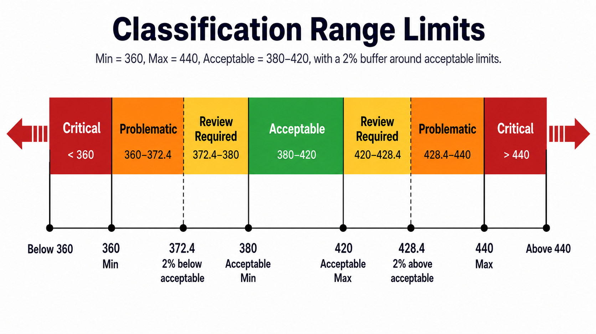

# SADINhub — Energy Meter Analytics

End-to-end analytics for a facility's electricity metering: ~19 months of readings from
31 meters (4.5M+ validated readings) turned into a cleaned PostgreSQL warehouse, Power BI
reporting, a live query dashboard, and a first ML layer for forecasting and anomaly triage.



## What's in here

| Folder | What it is |
|---|---|
| [`DATABASE/`](DATABASE/) | The SQL that builds the `sadinhub` warehouse — **bronze → silver → gold** layers, classify functions, views, reference data, and a schema-only `pg_dump`. Recovered from the live PostgreSQL 18 catalog and server logs; see [`DATABASE/README.md`](DATABASE/README.md). |
| [`ML_WORK/`](ML_WORK/) | Python ML pipeline: label replay (Task 0A/0B), **Model 1** raw-reading anomaly detection, **Model 2** next-day consumption forecaster, **Model 3** Isolation-Forest triage, and a **Task 4** human-review loop. Tests in `ML_WORK/tests/`. |
| [`LIVE_DASHBOARD/`](LIVE_DASHBOARD/) | A small Python server (`serve.py`) plus an HTML dashboard that queries the gold layer directly, so it shows individual readings and matches the Power BI totals. |
| [`POWER_BI/`](POWER_BI/) | The Power BI report as a **PBIP project** (report + semantic model definitions as text). The data cache is excluded. |
| [`reports/`](reports/) | Data Assessment Report, Data Dictionary and EDA Report (Markdown + PDF) and range-classification figures. |

## Architecture

```
Meter telemetry ─► bronze (raw source tables)
                     │  landing / staging views, classify_* functions
                     ▼
                   silver (typed, classified, quality-flagged)
                     │  materialized views, gap detection
                     ▼
                   gold (validated consumption, energy_raw, billing, date dim)
                     ├─► Power BI (PBIP)
                     ├─► LIVE_DASHBOARD (read-only queries)
                     └─► ML_WORK (read-only, REPEATABLE READ)
```

Design choices worth knowing:

- **Gold is the single source of truth for consumption.** The dashboard and ML code sum
  `gold` validated consumption rather than re-deriving deltas, so every surface agrees
  with Power BI.
- **Read-only everywhere.** Both the ML code and the dashboard force
  `default_transaction_read_only = on` and verify it before running any query.
- **No stored credentials.** Passwords come from environment variables
  (`SADINHUB_PASSWORD` for `DATABASE/` and `ML_WORK/`, `PGPASSWORD` for the dashboard) or an
  interactive prompt. `ML_WORK/src/db.py` refuses to load a config containing a password.
- **Dates bucket in Saudi time (UTC+3)**, not UTC — see `ML_WORK/src/saudi_time.py`.

## Running it

You need PostgreSQL with the `sadinhub` database restored. The meter data itself is **not**
included in this repository.

**Database** — apply the SQL in dependency order:

```bash
cd DATABASE
psql -d sadinhub -f APPLY_ORDER.sql
```

**ML pipeline** (Python 3.12):

```bash
cd ML_WORK
python -m venv .venv
.venv\Scripts\activate          # Windows; use `source .venv/bin/activate` elsewhere
pip install -r requirements.txt
python -m pytest -q
```

Tests that need the database or earlier run outputs (`ML_WORK/outputs/`, not committed) will
skip or error; the pure-logic tests run anywhere. Full stage-by-stage instructions are in
[`ML_WORK/docs/HOW_TO_RUN.md`](ML_WORK/docs/HOW_TO_RUN.md).

**Live dashboard:**

```bash
cd LIVE_DASHBOARD
set PGPASSWORD=<your password>   # or export PGPASSWORD=... on macOS/Linux
python serve.py
```

Then open <http://localhost:8770>. On Windows, `START_DASHBOARD.bat` does the same using the
`ML_WORK` virtual environment.

**Power BI:** open `POWER_BI/Sadin_Gold_DATA_dashboard.pbip` in Power BI Desktop and refresh
against your local `sadinhub` database.

## Results summary

- The cleaned pipeline reconciles exactly across SQL, Power BI and the live dashboard.
- Two data traps are handled explicitly: long telemetry gaps (which inflate naïve kWh sums)
  and vendor-corrupted billed-cost values.
- The Model 2 forecaster is documented honestly: see
  [`ML_WORK/docs/03_Model2_Forecaster_Results.pdf`](ML_WORK/docs/03_Model2_Forecaster_Results.pdf)
  and the non-technical [`SADINhub_Founder_Briefing.md`](ML_WORK/SADINhub_Founder_Briefing.md).

## Notes

- Built as a data science probation project for SADIN. Raw data, the `.pbix` file and ML
  outputs are excluded.
- No license file is included, so default copyright applies: the code is public to read, not
  licensed for reuse.
